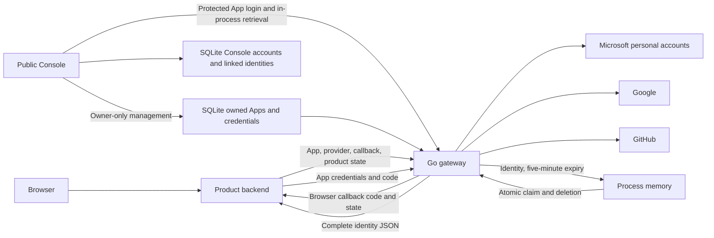

# UniAuth Blueprint

- Status: Agreed architecture
- Date: 2026-10-13
- Backend language: Go

## Purpose and ownership

UniAuth authenticates external accounts through personal Microsoft, Google, and
GitHub accounts and hands complete identity information to product backends.
It owns upstream authentication, App registration, credentials, and short-lived
flow state. External products own users, linking, permissions, and sessions.
The gateway stores no external product users or central SSO session.

UniAuth is also a public platform: anyone can sign in to its Console through any
configured provider and manage their own Apps. The Console is a protected App
using the same gateway. Its own accounts and explicit identity links persist in
SQLite, independently of external product identity handover. Administrator
visibility is limited to minimal user summaries and created-App counts. The
[platform decision](../../.agents/notes/implemented/architecture/2026-10-13-public-oauth-platform.md)
owns this Console authority and its data reset. The
[gateway decision](../../.agents/notes/implemented/architecture/2026-10-12-authentication-gateway.md)
retains external product ownership and handover alternatives. The
[references](../README.md) describe implemented API and configuration details;
[task evidence](../tasks/2026-10-12-authentication-gateway.md) distinguishes tests
from live upstream verification.

## Requirements

| ID | Required behavior |
| --- | --- |
| R1 | Implement the service and management API in Go. |
| R2 | Support personal Microsoft accounts, Google, and GitHub. |
| R3 | Provide a Console to register Apps and generate, name, describe, edit, rotate, reset, and revoke Secrets. |
| R4 | Return a standard identity profile and every obtained provider identity field under `origin`, within configured and granted scopes. |
| R5 | Retain complete identity results only in process memory for five minutes from creation. |
| R6 | Atomically consume an owning App's authenticated result once. |
| R7 | Leave external product users, linking, authorization, and login sessions to each product. |
| R8 | Return a callback code, then let the product backend retrieve identity JSON. |
| R9 | Provide Go and JavaScript product-backend SDKs for the existing protocol while retaining complete raw identity data and product-owned state/session persistence. |
| R10 | Authenticate the public Console only through configured OAuth providers, as a protected UniAuth App. |
| R11 | Persist provider-ID platform accounts and permit authenticated explicit identity linking without email-based account merging. |
| R12 | Enforce owner-only access to Apps and Secrets, including for administrators. |
| R13 | Claim initial administrator authority once through a configured verified email; allow only minimal user summaries and App counts to that administrator. |
| R14 | Reset all existing Apps and Secrets through migration 3, then persist the final platform schema without legacy ownership rules. |

## Architecture

The downstream interface is a login-and-retrieval HTTP protocol. Microsoft and
Google use upstream OIDC; GitHub uses authorization-code OAuth followed by
identity API calls. Keeping complete profiles in the backend response avoids
callback URL size limits and shared encryption-key lifecycle complexity.

| Component | Responsibility |
| --- | --- |
| `cmd/uniauth/` | Configuration, startup, signals. |
| `internal/server/` | Provider composition, HTTP routing, request logging, shutdown. |
| `internal/apps/` | SQLite migrations, platform accounts and identity links, owned App configuration, credential lifecycle. |
| `internal/providers/` | Three real provider adapters, source collection, and standard identity-field mapping. |
| `internal/auth/` | Browser-bound transactions, result expiry and atomic handover. |
| `internal/console/` | OAuth Console login/linking, sessions, owner management API, minimal administrator listing. |
| `web/console/` | React/TypeScript UI and embedded production assets. |
| `sdk/go/` | Standalone standard-library Go product client module. |
| `sdk/js/` | Node.js ESM product client package and TypeScript declarations. |

The provider interface represents three actual adapters. SQLite is a concrete
store. Each adapter maps its validated provider data into the standard profile.
The complete source JSON remains in `origin` as `json.RawMessage`, preserving
upstream-specific data alongside that profile. Provider mapping belongs in the
adapters, which know each upstream field's meaning; the handover service handles
App ownership, serialization, expiry, and single consumption.

## Application registry and Console

Each App has a generated ID, name, enabled state, exact callback URLs, and allowed
providers. Callbacks accept absolute HTTP or HTTPS URLs with a host, no user
information or fragment, and no reserved `code`, `state`, or `error` query
parameters. Matching preserves the registered string exactly. Separate environments
use separate registrations. Apps are confidential backend integrations; their
Secrets remain server-side. Random 256-bit Secrets are shown only when issued.
SQLite retains SHA-256 verification digests,
compared in constant time, with names, descriptions, and creation and revocation
metadata. Every credential has an operator-supplied name; an optional description
records its purpose or rotation notes. Names may repeat because the generated
ID identifies the credential. The Console separates unrevoked records in an
`Active` tab from revoked history in a `Disabled` tab and opens each App on
`Active`. Both views retain detail editing, while reset and revocation apply to
active records. Details remain editable after revocation without changing
credential validity or timestamps. Planned rotation allows old and new
credentials to coexist until the product switches and revokes the old one.
Reset atomically revokes one active Secret and issues a replacement with a new
ID and key, copying the selected credential's name and description. Subsequent
authentication rejects the old key. The Console confirms the affected named
credential and displays the replacement once. The
[reset decision](../../.agents/notes/implemented/feature/2026-10-13-secret-reset.md)
owns this lifecycle and its response-loss cost.

App creation may include initial Secret metadata to issue its first credential
atomically, or omit it to register an App without credentials. An App without a
Secret cannot authenticate result retrieval until its owner issues one.
Configuration replacement edits only the App. Later Secret creation and metadata
updates have separate JSON requests. Names contain 1–128 valid UTF-8 bytes with
no surrounding whitespace, CR, or LF. Descriptions contain up to 4096 valid UTF-8 bytes, preserving
whitespace and line breaks; omission means an empty description. Response
metadata always includes both fields. This keeps credential purpose available
after its one-time plaintext display. The
[Secret metadata decision](../../.agents/notes/implemented/feature/2026-10-13-secret-metadata.md)
owns credential metadata and the upgrade rationale. The
[App registration options decision](../../.agents/notes/implemented/feature/2026-10-22-app-registration-options.md)
owns HTTP callback support and optional initial issuance.

SQLite persists Console platform accounts, linked normalized identity profiles,
App ownership, configuration, and Secret verification records. Migration 3 clears
all pre-platform Apps and Secrets and establishes that schema; no seed account,
legacy owner, or row-compatibility branch is used. Products recreate registrations
and credentials after upgrading. Provider Client ID/Secret pairs remain deployment
configuration and are distinct from App credentials.

## Public Console accounts and authority

The `serve` command validates deployment configuration and reserves its TCP
listener before initializing the service. Database opening, migrations, pending
bootstrap updates, and protected Console App provisioning follow that reservation.
An occupied or unavailable listener therefore fails without changing database
state or the running process's Console credential. If service initialization
fails, the command closes the reserved listener and preserves the failure cause;
once initialized, the service owns it through serving and shutdown.

The server provisions a protected Console App. Its exact callback is
`<UNIAUTH_PUBLIC_URL>/console/auth/callback`; its allowed providers are all
configured upstream providers. Service initialization rotates its backend-only
random Secret and stores only the verification digest in SQLite. This rotation
continues on restart after listener reservation. Management APIs neither list
nor permit modification of that system App. Listener reservation does not make
later initialization failures transactional or support multiple instances sharing
a database on different addresses.

Console login starts the ordinary gateway authorization flow. At its callback,
Console consumes its browser-bound pending state, then retrieves the App-bound
result through the gateway's shared authenticated in-process operation. This
operation checks live App credentials and applies the same five-minute expiry
and atomic consumption as `/auth/result`, avoiding a network request back into
the same service. External products keep the existing HTTP protocol.

A new provider-qualified stable ID creates a platform account. Signing in through
a linked ID selects its existing account. Equal emails do not merge accounts.
Authenticated users can explicitly link another provider identity; linking
requires the initiating session to remain live through callback and final
attachment. An identity belonging to another account cannot move. The stored
profile is normalized Console identity data, without raw `origin` or upstream
tokens. This persistence applies only to Console users.

`UNIAUTH_INITIAL_ADMIN_EMAIL` is a plain email address in deployment configuration,
for example `sychenjianjun@gmail.com`. The first normalized identity with matching
email, compared case-insensitively, and `email_verified=true` atomically claims
bootstrap authority for its
actual account. Google or GitHub can supply this evidence; Microsoft's unknown
verification cannot claim it. There is no precreated administrator account.
Before the claim, startup may update the pending configured email. After the
claim, changing configuration never transfers administrator authority. Bootstrap
trusts the provider's verification assertion at verification time; it performs
no fresh mailbox challenge and does not guarantee continued mailbox control.

An administrator may view only user ID, name, email, creation time, and the number
of Apps each user created. No administrative endpoint exposes another user's
App definitions, callback/provider settings, Secret metadata or values, identity
links, or management controls. Every App and Secret operation requires the
session's owner ID inside the same storage query or transaction; a different
owner or the system App yields ordinary not-found behavior.

OAuth is the sole Console login mechanism. Password configuration and login input
are removed. At least one upstream provider is required at startup. The Console
session remains eight hours in memory with an HttpOnly, SameSite=Strict cookie,
Secure under HTTPS. Pending login and link state remains in memory for ten
minutes with a separate random HttpOnly, SameSite=Lax browser binding. Origin and
CSRF checks protect Console mutations. The expected origin uses lowercase IDNA
domain names, canonical IPv6 literals, and normalized ports with default ports
omitted; incoming Origin headers are compared exactly.

The Console owns one active OAuth initiation across sign-in and linking. The
selected button shows `Connecting…` and conflicting controls remain disabled
through the start request and external navigation, without changing the sign-in
card layout. This progress is separate from unfinished App work and its Secret
saving prompt. A failed start or completed interactive preview releases the
controls. Navigation cancellation releases only the attempt bound to its
Navigation API signal; browsers without that API retain an explicit recovery
path. During navigation, a fixed `Cancel sign-in` control stops the pending
browser load before releasing ownership, without moving the card. It also
recovers navigations that remain on the document without reporting cancellation.
A page restored from the browser history cache releases its navigation owner.
Late signals or completions from older attempts cannot release or replace a
newer attempt. Linking preserves its displayed identities during navigation;
only a completed in-page preview reloads them.

Console configuration editing, enable/disable changes, deletion, and Secret
creation, detail updates, reset, and revocation share one operation owner for
each App. Ownership is acquired before asynchronous work or render updates, so
overlapping controls cannot submit an older App snapshot. Opening an editor or
confirmation reserves the App until completion or cancellation. A newly issued
Secret keeps its one-time plaintext display and App ownership until the operator
marks the value saved and closes the dialog. Pending updates display
`Updating…`; committed response data becomes
the authoritative App configuration before later actions are allowed. A failed
configuration write keeps its owner while the UI reloads server configuration
and reconciles only the affected App. If that reload also fails, the App shows
`State unavailable` and new configuration actions remain blocked until explicit
Refresh succeeds. An already-open draft or delete confirmation retains its owner
and permits Retry or Cancel; it does not require Refresh before its owned retry.
An unavailable marker may remain after a successful owned retry until Refresh.
A session-invalidating `401` returns to login and discards idle drafts while
retaining owners of already in-flight requests until their handlers settle.
An already-authorized issuance can still succeed after another request reports
session expiry. Its successful one-time credential display retains ownership
through Saved and Done; a failed pending operation releases its retained owner.
This serialization is local to the Console, not a server-side version or
cross-browser concurrency guarantee.

React, TypeScript, Vite, and pnpm build the Console. Production assets are embedded
in the executable under `/console/`; Node.js is needed for building, not serving.
The interactive mockup uses the same components and styles with fixture Apps,
named active and revoked credentials, multiline descriptions, enabled/disabled
states, and error handling. Mockup fixtures are
excluded from production assets.

## Authentication and identity handover

1. The product binds a random `state` to the initiating browser's pending login
   and redirects to UniAuth with App ID, provider, registered callback, and state.
2. UniAuth validates the enabled App, provider eligibility, and exact callback.
   A ten-minute transient transaction stores separate provider state, PKCE,
   OIDC nonce, browser binding, product state, and approved callback.
3. The provider callback must match state, provider, and its unique flow cookie.
   Claiming consumes that transaction atomically. Provider exchange and source
   collection have bounded request-context deadlines.
4. UniAuth validates identity claims, collects complete provider sources, and
   maps standard identity fields. It rechecks App eligibility after upstream work
   and serializes the full result before publishing a code.
5. The App-bound result receives a random code and a deadline exactly five minutes
   after creation. UniAuth redirects to the registered product callback with
   `code` and the original product `state`.
6. The product validates and consumes its pending state before its backend posts
   the code to `/auth/result`, using HTTP Basic App ID/Secret authentication.
7. UniAuth authenticates the currently enabled App, checks result ownership and
   deadline, deletes a valid result atomically, and writes the identity response.
8. The product applies its own user, linking, authorization, and session policy.

Distinct flow cookies permit multiple login tabs without overwriting transaction
bindings. The gateway public origin requires HTTPS except for explicitly enabled
loopback HTTP. Product callbacks independently accept HTTP or HTTPS. Callback
parameters contain no identity payload or credentials.
Responses are not cacheable. The [API reference](../reference/api.md) defines
exact request limits, callback errors, and HTTP statuses.

## Product SDKs

Go and JavaScript SDKs implement the existing product login-and-retrieval
protocol. Their clients build validated authorization URLs, generate random state,
parse callback parameters against expected state, and issue one authenticated
result request. They have no administrator helpers, user store, product session,
or pending-login persistence. A product must atomically validate and consume its
browser-bound pending state before starting result retrieval.

The Go module is `github.com/codetreker/uniauth/sdk/go`, package `uniauth`, with
Go 1.27.1 and standard-library dependencies only. The JavaScript package is
`@codetreker/uniauth`, with ESM output and TypeScript declarations for Node.js 24
or later and no runtime dependencies. Both reject callback ambiguity and invalid
origins, require HTTPS for the gateway base origin except explicitly enabled
loopback HTTP, and accept HTTP or HTTPS product callbacks. They keep Secrets out
of authorization URLs.

Result retrieval uses HTTP Basic authentication and JSON over a single POST;
the SDKs do not follow redirects or retry consumption. Typed API errors retain
HTTP status, machine code, message, and request ID; malformed responses are
protocol errors, and transport causes remain available. A lost, aborted, or
invalid response may follow successful server consumption and requires a fresh
login. Default request deadlines are 30 seconds; Go accepts a configured HTTP
client, and JavaScript accepts a timeout and caller AbortSignal.

The SDKs require all seven standard identity fields from the server. Missing
fields or incompatible JSON types produce protocol errors; nullable strings,
nullable verification, and explicit `false` are returned without substitution.
The SDKs expose the server's normalized profile without deriving fields from
`origin` or retaining old response aliases. Go exposes `ID`, nullable profile
pointers, `Origin` as `map[string]json.RawMessage`, and the entire body as `RawJSON`.
JavaScript exposes the exact snake-case wire fields with unknown original data
under `origin` and authoritative `rawJSON`; ordinary parsed JavaScript numbers
cannot preserve every integer or decimal exactly. The
[SDK reference](../reference/sdks.md) owns examples and exact API contracts, and
the [SDK decision](../../.agents/notes/implemented/feature/2026-10-13-product-sdks.md)
records these responsibilities. Local package consumers validate Go imports and
packed JavaScript code and types; package metadata alone does not establish a
registry release.

## Standard identity and complete provider sources

The envelope always contains `provider`, `id`, `email`, `email_verified`, `name`,
`avatar_url`, and `origin`. The provider-qualified `id` is required and preserves
the stable upstream identity. Optional strings are `null` when missing, null,
or empty. Verification is `true`, `false`, or `null`; unknown verification is
never converted to `false`. A known normalization field with an incompatible
non-null JSON type fails authentication. Products can read common attributes
without interpreting each provider's source layout.

Each adapter defines the selection of standard fields. Google uses canonical
UserInfo fields. Microsoft selects Graph `mail`, then the ID-token `email`, and
Graph `displayName`, then the ID-token `name`; verification remains unknown.
Its fetched photo becomes a data URL in `avatar_url`, with `null` for photo
`404`. GitHub selects a nonempty primary email from the complete email list,
then public profile `email` if no usable primary email exists. GitHub email
verification comes only from an exact matching email-list entry, while its
name and avatar come from the profile. The [API reference](../reference/api.md)
owns the exact field mappings and absence rules.

`origin` retains complete source objects, including unknown fields, explicit
nulls, false values, full email lists, and nested objects. Missing source fields
remain missing. Completeness covers obtained information under granted scopes;
it does not fabricate absent attributes or extend access beyond those scopes.
Provider failures stop authentication rather than producing an empty profile.
The [normalization decision](../../.agents/notes/implemented/architecture/2026-10-13-normalized-identity.md)
owns the response format, provider mapping responsibilities, and compatibility
costs; the gateway decision continues to own authentication and handover.

| Provider | Validation and `origin` sources | Stable `id` |
| --- | --- | --- |
| Microsoft | Personal-account `consumers` authorization and token endpoints; RS256 signature, fixed personal issuer, audience, expiry, issued-at, nonce, authorized party, and access-token hash when present. Require personal `tid` and `oid`; retain ID claims, Graph `/me`, and photo bytes. | `microsoft:9188040d-6c67-4c5b-b112-36a304b66dad:<oid>` |
| Google | OIDC discovery and token validation; UserInfo `sub` must match the token. Retain complete ID claims and UserInfo. | `google:` |
| GitHub | PKCE code exchange, authenticated `/user`, and every `/user/emails` page. Require a positive numeric profile ID. | `github:<id>` |

Microsoft requests `openid profile email` and delegated Graph `User.Read`.
Authorization always includes `prompt=select_account` to request an account
chooser with remembered accounts and an option to use another account, even when
a provider session exists.
This policy belongs to the shared Microsoft adapter and covers product login,
Console login, and identity linking without adding configuration or protocol
options. Its App registration supports `PersonalMicrosoftAccount`; organization
accounts fail the fixed personal-tenant and issuer validation. Graph photo `404` is an
explicit `null` in `origin`; successful photos include content type and standard
Base64 bytes. The avatar data URL uses those same bytes and the parsed image
media type, requiring no additional fetch. Other photo/profile retrieval
failures stop authentication. Google requests `openid profile email`; GitHub
requests `read:user user:email`. Google and GitHub image URLs appear in the
standard profile and remain source attributes without downloading the image.

Emails and mutable usernames are not identity keys. ID generation does not use
App Secrets. Cross-provider IDs remain distinct; changing their values requires
an explicit product identity migration. Tokens, raw signed ID tokens, refresh
tokens, upstream authorization codes, and Secrets are outside the identity-data
package. The response does not expose `subject` or `sources` compatibility
aliases.

## Transient state and durability

Transaction and result maps are mutex-protected. Claim ownership, deadline checks,
and deletion occur together. The completed payload is immutable and serialized
before caching, so serialization failure cannot consume a published result.

- Exactly one concurrent valid retrieval succeeds.
- Invalid credentials and other-App probes leave the rightful live result intact.
- A deadline is enforced on every claim; expiry begins at the deadline, independently
  of periodic cleanup.
- Count and accounted-byte limits explicitly reject new work. Active callbacks
  keep their transaction reservation until provider work completes; accepted live
  results are not silently evicted or truncated. Accounted payload bytes include
  standard fields and `origin`, including both copies of Microsoft photo data.
- Unknown, consumed, expired, and other-App result codes return an unavailable
  result without retained code history.

A successful claim means server acceptance and deletion before response writing.
It cannot prove client receipt. A lost response after consumption requires a
fresh login. Process restart loses pending transactions, results, and Console
sessions while retaining platform accounts, links, and owned App configuration.

Deploy one process. A login's authorization, provider callback, and retrieval must
reach that process. Multiple replicas need a separate routing or shared-state
decision. On shutdown the server stops accepting work, drains accepted HTTP
requests within a bounded deadline, then releases transient state and SQLite.

## Observability and validation

Structured logs correlate HTTP request IDs and login operation IDs with App ID,
provider, phase, and sanitized error categories. Successful result retrieval gets
its operation ID from the live result before deletion. Later unavailable claims
can use request ID and authenticated App ID; their original operation ID need not
survive. Cleanup reports aggregate expiration counts. Console configuration
changes and Secret detail updates have management operation, opaque platform actor
account, and affected App IDs for audit correlation; metadata updates use
`secret.update`.

Logs exclude identity payloads, upstream identity IDs, emails, result codes, product
or provider state, Secrets, Secret names and descriptions, App display data,
authorization headers, tokens, and full sensitive URLs. Reverse-proxy configuration must preserve that exclusion. Provider errors
retain causes internally while emitting safe operation and failure categories.

The authoritative go-cov policy requires total, package, and function coverage,
critical-block coverage, and race detection without exclusions. Tests cover
caller-visible state and identity checks, expiry boundaries, wrong-App probes,
concurrent claims, capacity, lost-response behavior, restarts, and lifecycle
shutdown. Frontend and browser checks cover real Console management and
production-component mockup interactions.

Automated fixtures do not prove provider registrations or interactive consent.
Fresh personal Microsoft, Google, and GitHub login verification belongs to
post-deployment validation with actual credentials. See the
[implementation receipt](../tasks/2026-10-12-authentication-gateway.md) for observed
results rather than assuming checks passed.

## References

- [Microsoft personal-account authority and OIDC flow](https://learn.microsoft.com/en-us/entra/identity-platform/v2-protocols-oidc)
- [Microsoft authorization prompt behavior](https://learn.microsoft.com/en-us/entra/identity-platform/v2-oauth2-auth-code-flow#request-an-authorization-code)
- [Microsoft application audience](https://learn.microsoft.com/en-us/entra/identity-platform/reference-app-manifest)
- [Microsoft ID-token claims](https://learn.microsoft.com/en-us/entra/identity-platform/id-token-claims-reference)
- [Microsoft Graph profile](https://learn.microsoft.com/en-us/graph/api/user-get)
- [Microsoft Graph profile photo](https://learn.microsoft.com/en-us/graph/api/profilephoto-get)
- [Google OpenID Connect](https://developers.google.com/identity/openid-connect/openid-connect)
- [GitHub OAuth authorization flow](https://docs.github.com/en/apps/oauth-apps/building-oauth-apps/authorizing-oauth-apps)
- [GitHub identity identifiers](https://docs.github.com/en/apps/oauth-apps/building-oauth-apps/best-practices-for-creating-an-oauth-app)
- [GitHub profile API](https://docs.github.com/en/rest/users/users#get-the-authenticated-user)
- [GitHub email API](https://docs.github.com/en/rest/users/emails#list-email-addresses-for-the-authenticated-user)
- [OIDC UserInfo subject validation](https://openid.net/specs/openid-connect-core-1_0.html#UserInfoResponse)
- [Authorization-code binding and single-use rules](https://www.rfc-editor.org/rfc/rfc6749#section-4.1.2)
