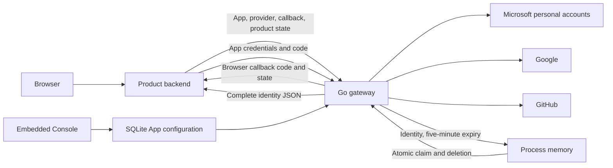

# UniAuth Blueprint

- Status: Agreed architecture, implemented by the authentication gateway delivery
- Date: 2026-10-12
- Backend language: Go

## Purpose and ownership

UniAuth authenticates external accounts through personal Microsoft, Google, and
GitHub accounts and hands complete identity information to product backends.
It owns upstream authentication, application registration, credentials, and
short-lived flow state. Products own users, account linking, permissions, and
login sessions. Authenticating a product user grants no Console authority.

There is no persistent end-user database, profile store, cross-provider linking
record, or central SSO session. The administrator Console uses a separate
password and in-memory session. The
[architecture decision](../../.agents/notes/implemented/architecture/2026-10-12-authentication-gateway.md)
records the considered alternatives and accepted costs. The
[references](../README.md) describe implemented API and configuration details;
[task evidence](../tasks/2026-10-12-authentication-gateway.md) distinguishes tests
from live upstream verification.

## Requirements

| ID | Required behavior |
| --- | --- |
| R1 | Implement the service and management API in Go. |
| R2 | Support personal Microsoft accounts, Google, and GitHub. |
| R3 | Provide a Console to register Apps and generate, rotate, and revoke Secrets. |
| R4 | Hand over every identity field obtained under the configured and granted scopes. |
| R5 | Retain complete identity results only in process memory for five minutes from creation. |
| R6 | Atomically consume an owning App's authenticated result once. |
| R7 | Leave users, linking, authorization, and login sessions to each product. |
| R8 | Return a callback code, then let the product backend retrieve identity JSON. |

## Architecture

The downstream interface is a login-and-retrieval HTTP protocol. Microsoft and
Google use upstream OIDC; GitHub uses authorization-code OAuth followed by
identity API calls. Keeping complete profiles in the backend response avoids
callback URL size limits and shared encryption-key lifecycle complexity.

| Component | Responsibility |
| --- | --- |
| `cmd/uniauth/` | Configuration, password-hash command, startup, signals. |
| `internal/server/` | Provider composition, HTTP routing, request logging, shutdown. |
| `internal/apps/` | SQLite migrations, App configuration, credential lifecycle. |
| `internal/providers/` | Three real provider adapters and identity-source collection. |
| `internal/auth/` | Browser-bound transactions, result expiry and atomic handover. |
| `internal/console/` | Administrator password verification, sessions, management API. |
| `web/console/` | React/TypeScript UI and embedded production assets. |

The provider interface represents three actual adapters. SQLite is a concrete
store. Source JSON is retained as `json.RawMessage` rather than reduced to a
common profile model, preserving upstream-specific data.

## Application registry and Console

Each App has a generated ID, name, enabled state, exact callback URLs, and allowed
providers. Separate environments use separate registrations. Apps are confidential
backend integrations; their Secrets remain server-side. Random 256-bit Secrets
are shown only when created. SQLite retains SHA-256 verification digests,
compared in constant time, with creation and revocation metadata. Rotation allows
old and new credentials to coexist until the product switches and revokes the
old one.

SQLite persists only configuration and product Secret verification records.
Embedded migrations establish the schema without an end-user table. Provider
Client ID/Secret pairs come from deployment configuration and are distinct from
Console-generated product credentials. Missing providers are unavailable rather
than given fallback credentials.

The Console authenticates a deployment-configured Argon2id password hash. A
standalone CLI reads the password from stdin, hides terminal input, and outputs
the PHC hash without password arguments. An eight-hour in-memory administrator
session uses an HttpOnly, SameSite=Strict cookie, Secure under HTTPS. Mutations
require exact Origin and CSRF validation. Login attempts and concurrent password
verification are bounded. Restart invalidates these administrator sessions.

React, TypeScript, Vite, and pnpm build the Console. Production assets are embedded
in the executable under `/console/`; Node.js is needed for building, not serving.
The interactive mockup uses the same components and styles with fixture Apps,
credentials, enabled/disabled states, and error handling. Mockup fixtures are
excluded from production assets.

## Authentication and identity handover

1. The product binds a random `state` to the initiating browser's pending login
   and redirects to UniAuth with App ID, provider, registered callback, and state.
2. UniAuth validates the enabled App, provider eligibility, and exact callback.
   A ten-minute transient transaction stores separate provider state, PKCE,
   OIDC nonce, browser binding, product state, and approved callback.
3. The provider callback must match state, provider, and its unique flow cookie.
   Claiming consumes that transaction atomically. Provider exchange and source
   collection have bounded request-context deadlines.
4. UniAuth validates identity claims and collects complete provider sources.
   It rechecks App eligibility after upstream work and serializes the full result
   before publishing a code.
5. The App-bound result receives a random code and a deadline exactly five minutes
   after creation. UniAuth redirects to the registered product callback with
   `code` and the original product `state`.
6. The product validates and consumes its pending state before its backend posts
   the code to `/auth/result`, using HTTP Basic App ID/Secret authentication.
7. UniAuth authenticates the currently enabled App, checks result ownership and
   deadline, deletes a valid result atomically, and writes the identity response.
8. The product applies its own user, linking, authorization, and session policy.

Distinct flow cookies permit multiple login tabs without overwriting transaction
bindings. HTTPS is required in production; loopback HTTP is an explicit local
configuration. Callback parameters contain no identity payload or credentials.
Responses are not cacheable. The [API reference](../reference/api.md) defines
exact request limits, callback errors, and HTTP statuses.

## Complete provider sources

The envelope contains `provider`, a provider-qualified `subject`, and nested
`sources`. Unknown source fields, nulls, false values, full email lists, and nested
objects remain available to the product. Completeness covers obtained information
under granted scopes; it does not fabricate absent attributes or extend access
beyond those scopes. Missing verification information remains unknown. Provider
failures stop authentication rather than producing an empty profile.

| Provider | Validation and sources | Subject |
| --- | --- | --- |
| Microsoft | Personal-account `consumers` authorization and token endpoints; RS256 signature, fixed personal issuer, audience, expiry, issued-at, nonce, authorized party, and access-token hash when present. Require personal `tid` and `oid`; retain ID claims, Graph `/me`, and photo bytes. | `microsoft:9188040d-6c67-4c5b-b112-36a304b66dad:<oid>` |
| Google | OIDC discovery and token validation; UserInfo `sub` must match the token. Retain complete ID claims and UserInfo. | `google:` |
| GitHub | PKCE code exchange, authenticated `/user`, and every `/user/emails` page. Require a positive numeric profile ID. | `github:<id>` |

Microsoft requests `openid profile email` and delegated Graph `User.Read`.
Its App registration supports `PersonalMicrosoftAccount`; organization accounts
fail the fixed personal-tenant and issuer validation. Graph photo `404` is an
explicit `null`; successful photos include content type and standard Base64
bytes. Other photo/profile retrieval failures stop authentication. Google requests
`openid profile email`; GitHub requests `read:user user:email`. Google and GitHub
image URLs remain source attributes without downloading the image.

Emails and mutable usernames are not identity keys. Subject generation does not
use App Secrets. Cross-provider subjects remain distinct; changing their format
requires an explicit product identity migration. Tokens, raw signed ID tokens,
refresh tokens, upstream authorization codes, and Secrets are outside the
identity-data package.

## Transient state and durability

Transaction and result maps are mutex-protected. Claim ownership, deadline checks,
and deletion occur together. The completed payload is immutable and serialized
before caching, so serialization failure cannot consume a published result.

- Exactly one concurrent valid retrieval succeeds.
- Invalid credentials and other-App probes leave the rightful live result intact.
- A deadline is enforced on every claim; expiry begins at the deadline, independently
  of periodic cleanup.
- Count and accounted-byte limits explicitly reject new work. Active callbacks
  keep their transaction reservation until provider work completes; accepted live
  results are not silently evicted or truncated.
- Unknown, consumed, expired, and other-App result codes return an unavailable
  result without retained code history.

A successful claim means server acceptance and deletion before response writing.
It cannot prove client receipt. A lost response after consumption requires a
fresh login. Process restart loses pending transactions, results, and Console
sessions while retaining App configuration.

Deploy one process. A login's authorization, provider callback, and retrieval must
reach that process. Multiple replicas need a separate routing or shared-state
decision. On shutdown the server stops accepting work, drains accepted HTTP
requests within a bounded deadline, then releases transient state and SQLite.

## Observability and validation

Structured logs correlate HTTP request IDs and login operation IDs with App ID,
provider, phase, and sanitized error categories. Successful result retrieval gets
its operation ID from the live result before deletion. Later unavailable claims
can use request ID and authenticated App ID; their original operation ID need not
survive. Cleanup reports aggregate expiration counts. Console configuration
changes have management operation and affected App IDs for audit correlation.

Logs exclude identity payloads, account identifiers, emails, result codes, product
or provider state, Secrets, authorization headers, tokens, and full sensitive
URLs. Reverse-proxy configuration must preserve that exclusion. Provider errors
retain causes internally while emitting safe operation and failure categories.

The authoritative go-cov policy requires total, package, and function coverage,
critical-block coverage, and race detection without exclusions. Tests cover
caller-visible state and identity checks, expiry boundaries, wrong-App probes,
concurrent claims, capacity, lost-response behavior, restarts, and lifecycle
shutdown. Frontend and browser checks cover real Console management and
production-component mockup interactions.

Automated fixtures do not prove provider registrations or interactive consent.
Fresh personal Microsoft, Google, and GitHub login verification belongs to
post-deployment validation with actual credentials. See the
[implementation receipt](../tasks/2026-10-12-authentication-gateway.md) for observed
results rather than assuming checks passed.

## References

- [Microsoft personal-account authority and OIDC flow](https://learn.microsoft.com/en-us/entra/identity-platform/v2-protocols-oidc)
- [Microsoft application audience](https://learn.microsoft.com/en-us/entra/identity-platform/reference-app-manifest)
- [Microsoft ID-token claims](https://learn.microsoft.com/en-us/entra/identity-platform/id-token-claims-reference)
- [Microsoft Graph profile](https://learn.microsoft.com/en-us/graph/api/user-get)
- [Microsoft Graph profile photo](https://learn.microsoft.com/en-us/graph/api/profilephoto-get)
- [Google OpenID Connect](https://developers.google.com/identity/openid-connect/openid-connect)
- [GitHub OAuth authorization flow](https://docs.github.com/en/apps/oauth-apps/building-oauth-apps/authorizing-oauth-apps)
- [GitHub identity identifiers](https://docs.github.com/en/apps/oauth-apps/building-oauth-apps/best-practices-for-creating-an-oauth-app)
- [GitHub profile API](https://docs.github.com/en/rest/users/users#get-the-authenticated-user)
- [GitHub email API](https://docs.github.com/en/rest/users/emails#list-email-addresses-for-the-authenticated-user)
- [OIDC UserInfo subject validation](https://openid.net/specs/openid-connect-core-1_0.html#UserInfoResponse)
- [Authorization-code binding and single-use rules](https://www.rfc-editor.org/rfc/rfc6749#section-4.1.2)
